<!--
  Hey, source reader 👋 If you open READMEs in raw mode, we'll probably get along.
  Say hi: jobs@srs404.com
-->

<a href="https://srs404.com"></a>

<p align="center">
  <a href="https://srs404.com"></a>
  <a href="mailto:jobs@srs404.com"></a>
  <a href="https://www.linkedin.com/in/srs404/"></a>
  <a href="https://srs404.com/resume.pdf"></a>
  <a href="https://www.instagram.com/srs404_/"></a>
</p>

<p align="center"><i>Eight years turning complex systems into calm, dependable software, from full-stack builds to infrastructure and the teams that ship both.</i></p>

<br>

### `01` About

I work where **software, servers and people** meet. By day I'm an **IT Project Leader at Gatestone & Co.**, moving our infrastructure to the cloud and keeping clients, vendors, IT and leadership pointed the same way. After hours I build security-first products at **[Leylance](https://leylance.com)**, my software studio.

```yaml
# ~/srs404.yml
name:    Sami Rahman
based:   Oshawa, ON, Canada
role:    IT Project Leader
at:      Gatestone & Co.
studio:  Leylance
stack:   [python, php, js, sql]
infra:   [aws, docker, linux, k8s]
now:     cloud migration ☁️
open_to: new projects ✅
motto:   stay absolute.
```

<br>

### `02` Experience

- **IT Project Leader** · Gatestone & Co. · `2025 → now`<br>
  Leading the server move to the cloud with an AWS partner, coordinating the datacenter migration, and planning onboarding with VPs, SVPs and the President.
- **IT Manager** · TripUp · `2023 → 2024`<br>
  Ran IT operations and software delivery end to end, and shipped an invoicing platform with facial recognition and ID verification.
- **Software Engineer** · Travela · `2021 → 2022`<br>
  Built and hardened travel-tech web apps, containerized them with Docker and Kubernetes, and kept CI/CD fast and boring.

<details>
<summary><b>Earlier orbits</b> · 2017 → 2021</summary>
<br>

- **Web Lead** · NSU ACM Student Chapter · `2019 → 2021`<br>
  A member portal with social features and an interview-scheduling system for recruiting.
- **Full-Stack WordPress Developer** · Dhaka Chemicals · `2018 → 2020`<br>
  A LAMP catalogue site taken to the top of Google, tuned to a 97% GTmetrix score.
- **Software Developer** · Liquor Lounge · `2017 → 2019`<br>
  A touch-first VB.NET point of sale on Microsoft SQL, with inventory, invoicing and sales analytics.

</details>

The full story is in my **[résumé →](https://srs404.com/resume.pdf)**

<br>

### `03` Work

Everything I build beyond the day job ships under **[Leylance](https://leylance.com)**: security-first products, from store apps to client sites raised from an empty domain.

<p align="center">
  <a href="https://ervun.com"></a>
  <a href="https://play.google.com/store/apps/details?id=com.wistrie.wistrie"></a>
  <a href="https://srs404.com/#work"></a>
  <a href="https://srs404.com/#work"></a>
  <a href="https://srs404.com/#work"></a>
  <a href="https://srs404.com/#work"></a>
</p>

**From the open-source shelf**

- [**Xemote**](https://github.com/srs404/Xemote): control your own devices from anything with a browser&nbsp;· `Python`
- [**TweeBot**](https://github.com/srs404/TweeBot): a Twitter bot with ChatGPT built in&nbsp;· `Python`
- [**Order-Management-System**](https://github.com/srs404/Order-Management-System): secure order processing and management&nbsp;· `PHP`
- [**Digital-Uptime-Footprint**](https://github.com/srs404/Digital-Uptime-Footprint): my personal uptime and productivity tracker&nbsp;· `Python`
- [**Point-Of-Sale-Software**](https://github.com/srs404/Point-Of-Sale-Software): where it all started, a client POS&nbsp;· `VB.NET`

<br>

### `04` Toolkit

**Languages**<br>


**Web & data**<br>


**Cloud & infrastructure**<br>


**AI & automation**&nbsp;· LLM apps&nbsp;· AI integration&nbsp;· prompt engineering&nbsp;· script automation<br>
**Delivery**&nbsp;· Agile & Scrum&nbsp;· Azure DevOps&nbsp;· MS Project&nbsp;· ServiceDesk Plus&nbsp;· Kanban

<br>

### `05` Say hello

Have a project, a role, or a system that needs an owner? **[jobs@srs404.com](mailto:jobs@srs404.com)** lands straight in my inbox, or find me on **[LinkedIn](https://www.linkedin.com/in/srs404/)**.

<sub>P.S. The 404 in my handle is the only one you'll ever get from me.</sub>

<br>

<p align="center">
  <a href="https://srs404.com"></a>
</p>
